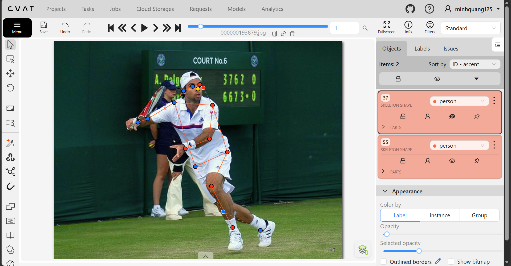
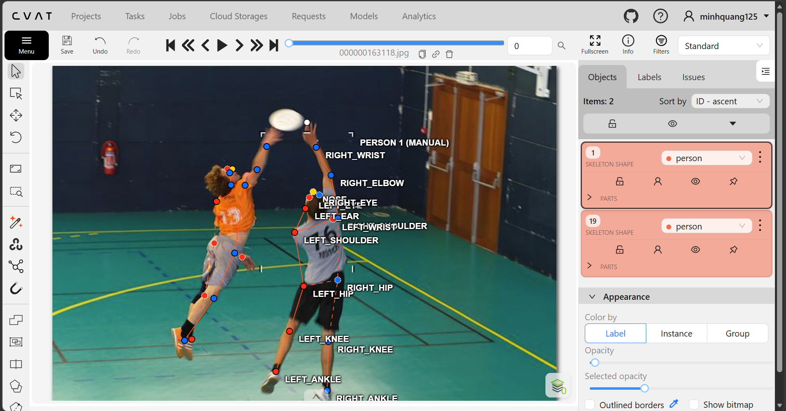
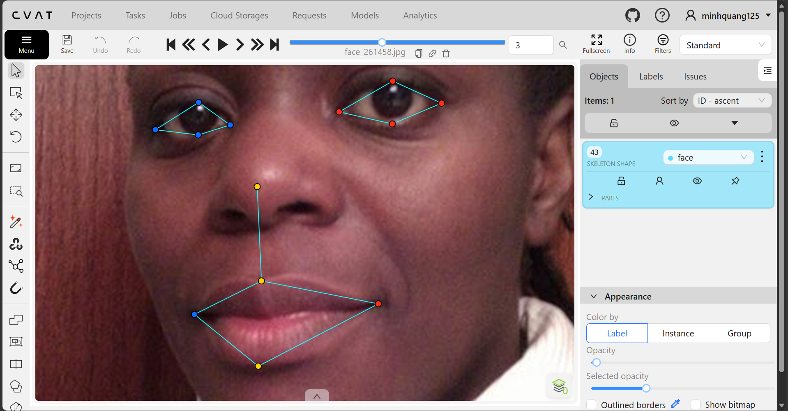
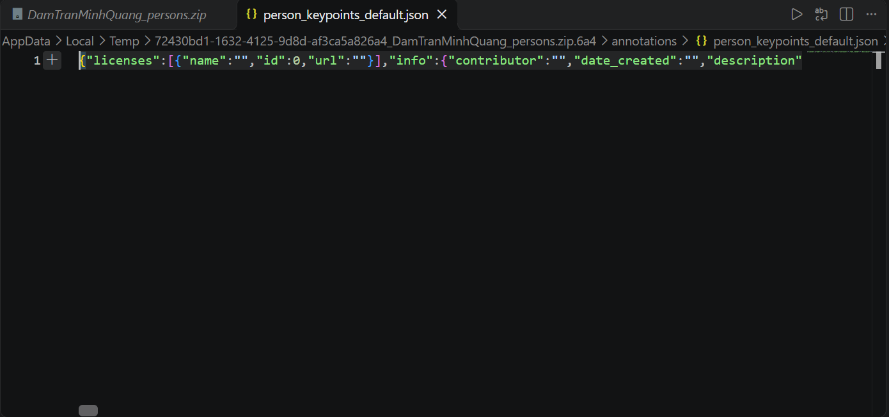

# Báo cáo cá nhân — DamTranMinhQuang-2A202603336

Đổi tên file theo quy tắc `MSSV_HoTen.md`. Ví dụ: `20241234_NguyenVanAn.md`.

Dữ liệu: 12 ảnh người COCO val2017 (Lin et al., 2014) và 8 ảnh chân dung Wikimedia Commons, chỉ dùng trong lớp.

## 0. Thông tin học viên

- Họ tên: Đàm Trần Minh Quang
- MSSV: 2A202603336
- Email: 26ai.quangdtm@vinuni.edu.vn
- Link repository: https://github.com/damtranminhquang125-oss/K5-L2B-Day04-DamTranMinhQuang-2A202603336-KeypointPose-Student
- Phiên bản CVAT (Help → About): 2.82.1
- Máy: hệ điều hành Win 11 · RAM 32 GB · chạy CVAT chế độ đầy đủ
- Bộ ảnh (`src/exports/assignment.json` do `lab.py setup` tạo): có
- Giờ bắt đầu: 16h30
- Giờ kết thúc: 19h30

## 1. Kiểm tra label (CP0)

| Label | Kiểu | Số điểm | Tên điểm đúng bảng của lab? | Đúng thứ tự? | Số cạnh |
|---|---|---:|---|---|---:|
| `person` | skeleton 'person' | 17 | nose, left_eye, right_eye, left_ear, right_ear, left_shoulder, right_shoulder, left_elbow, right_elbow, left_wrist, right_wrist, left_hip, right_hip, left_knee, right_knee, left_ankle, right_ankle | Có | 19 |
| `face` | skeleton 'face' | 13 | left_eye_outer, left_eye_inner, left_eye_upper, left_eye_lower, right_eye_outer, right_eye_inner, right_eye_upper, right_eye_lower, nose_tip, mouth_left, mouth_right, lip_upper, lip_lower | Có | 13 |

Mẫu `person` dựng theo người quay mặt về camera (các điểm `left_*` nằm bên phải khung mẫu)? Không

Cách đổi cờ `occluded` / `outside` cho **một điểm** trên phiên bản CVAT này (một câu):

Right click vào key point, O - outside, Q - occluded

## 2. Số lượng đã gán và thời gian (CP1, CP2)

| Nhóm ảnh | Số ảnh | Số skeleton đã gán | Số người dưới 60 px (không gán) | Số poster / gương / màn hình bỏ qua | Thời gian (phút) |
|---|---:|---:|---:|---:|---:|
| `easy` | 5 | 14 | 2 | 0 | 1h |
| `occluded` | 3 | 10 | 0 | 0 | 1h |
| `back` | 2 | 5 | 0 | 0 | 1h |
| `small` | 1 | 0 | 1 | 0 | 1h |
| `crowd` | 1 | 2 | 0 | 0 | 10' |
| `faces` | 8 | 8 | 0 | 0 | 30' |

- Số ảnh người đã xong ở mốc phút 105: 10 / 10
- Thời gian thực tế (phút): CP1 1h · CP2 1h · CP3 1h
- Ảnh tốn thời gian nhất là ảnh nào, vì sao? Ảnh 000000253584.jpg có người trượt tuyết đang co người vì quần áo thùng thình, vài phụ kiện bao một phần cơ thể và người co lại khiến các key point rất khó nhìn và khó khớp

...

## 3. Bảng ca khó (CP1, CP2)

Mỗi điểm bạn phân vân một dòng, nhất là phân vân giữa `v = 1` và `v = 0`, hoặc không chắc hướng người.

| Ảnh | Người / mặt | Điểm | Cờ đã chọn | Phân vân giữa | Lý do chọn |
|---|---|---|---:|---|---|
| 000000163118.jpg | Người | left_wrist | v=1 | v=0 | Nhìn rõ tay nhưng bị che cả cánh tay |
| 000000211458.jpg | Người | right_elbow | v=1 | v=2 | Quần áo thùng thình nhưng tay gập |
| 000000253584.jpg | Người | left_knee | v=1 | v=0 | 2 đầu gối chụm vào nhau |
| face_223746.jpg | Mặt | right_eye_upper | v=1 | v=0 | Con ngươi bị che mất 1 nửa do người đang nhìn sang |

## 4. Bảng tự review (CP3)

Đi từ ảnh cuối về ảnh đầu. 5 ảnh người (ít nhất 2 ảnh `back` hoặc `crowd`) và 3 ảnh mặt. Ít nhất 8 dòng, kể cả dòng `ok`. Ghi lỗi trước, sửa sau.

Mã lỗi dùng đúng một trong: `lr_swap`, `vis_flag`, `position`, `missing`, `extra`, `ok`.

| Ảnh | Người / mặt | Điểm | Mã lỗi | Ghi chú | Đã sửa? |
|---|---|---|---|---|---|
| 000000521817.jpg | Người | left_elbow | lr_swap  | Đầu quay mặt về camera nhưng thân quay lưng | Trả về đúng vị trí trái của thân |
| 000000508269.jpg | Người | right_ankle | lr_swap | 2 chân vắt chéo nhau | Trả về đúng vị trí phải |
| 000000429594.jpg | Người | right_knee | vis_flag | Người mặc quần thùng thình không rõ đầu gối | v=2 thành v=1 |
| 000000413160.jpg | Người | left_wrist | vis_flag | Tư thế người chống tay xuống, thấy 1 phần bàn tay | v=0 thành v=1 |
| 000000391222.jpg | Người | right_wrist | vis_flag | 2 cổ tay đan chéo nhau, trái che phải | v=0 thành v=1 |
| face_575921.jpg | Mặt | mouth_right | vis_flag | Râu che khóe miệng nhưng vẫn nhìn được | v=1 thành v=2 |
| face_223746.jpg | Mặt | right_eye_upper | vis_flag | Con ngươi bị che 1 nửa do người đang nhìn sang trái | v=2 thành v=1 |
| face_13874.jpg | Mặt | 8 điểm mắt | vis_flag | Người đang đeo kính râm không nhìn thấy mắt | v=0 thành v=1 |

Tổng hợp số lỗi theo mã:

| `lr_swap` | `vis_flag` | `position` | `missing` | `extra` | `ok` |
|---:|---:|---:|---:|---:|---:|
| 2 | 6 | 0 | 0 | 0 | 0 |

Điểm còn phân vân giữa `v = 1` và `v = 0` (ghi cả hai lựa chọn và lý do chọn):

...

## 5. Kiểm file xuất và kết quả tự kiểm (CP4)

Tự kiểm tay trong file JSON:

| File | Người / mặt kiểm (ảnh, thứ tự) | Số phần tử `keypoints` | Điểm `outside` ra `v = 0`, `occluded` ra `v = 1`? | `num_keypoints` khớp? |
|---|---|---:|---|---|
| `HoVaTen_persons.zip` | Người (12 ảnh) | 17 | 63, 69 | 13.7 |
| `HoVaTen_faces.zip` | Mặt (8 ảnh) | 13 | 1, 14 | 12.9 |

Sau khi xuất, CVAT ghi `occluded` thành `v = 1` và `outside` thành `v = 0`. Tọa độ của điểm `outside` trong file là `0, 0` hay tọa độ cũ? Tọa độ cũ

Hai job đã chuyển sang completed trên CVAT? Có

Dán phần **TÓM TẮT** in ra từ `src/check_submission.py`:

```text
----- TÓM TẮT (dán vào báo cáo mục 5) -----
- File person: DamTranMinhQuang_persons.zip
  Số ảnh: 12 · số skeleton `person`: 19 · mỗi annotation 51 số
  Skeleton theo ảnh: 000000163118=2, 000000193879=2, 000000201702=1, 000000211458=1, 000000253584=1, 000000336477=1, 000000375535=2, 000000391222=2, 000000413160=3, 000000429594=1, 000000508269=1, 000000521817=2
  Cờ v: v=2 191 (59%) · v=1 69 (21%) · v=0 63 (20%)
  num_keypoints trung bình: 13.7
- File face: DamTranMinhQuang_faces.zip
  Số ảnh: 8 · số skeleton `face`: 8 · mỗi annotation 39 số
  Skeleton theo ảnh: face_13874=1, face_204787=1, face_223746=1, face_261458=1, face_264124=1, face_279764=1, face_575921=1, face_81239=1
  Cờ v: v=2 89 (86%) · v=1 14 (13%) · v=0 1 (1%)
  num_keypoints trung bình: 12.9
- Ghi chú: 64 điểm v = 0 vẫn mang tọa độ cũ (CVAT 2.x xuất như vậy; chuẩn COCO ghi 0, 0). Không phải lỗi: điểm v = 0 bị bỏ qua khi huấn luyện và khi chấm.
- Số [LỖI]: 0 · số [CẢNH BÁO]: 6
Kết quả: ĐẠT (đọc lại từng cảnh báo ở trên)
```

Các `[CẢNH BÁO]` còn giữ nguyên và lý do:

[CẢNH BÁO] 000000163118.jpg #1: cặp wrist nằm ngược phía so với các cặp còn lại. Có thể đổi trái/phải một cặp (`lr_swap`), hoặc tay / chân bắt chéo thật: kiểm lại.
- left_wrist vắt sang phải

[CẢNH BÁO] 000000163118.jpg #2: cặp ankle nằm ngược phía so với các cặp còn lại. Có thể đổi trái/phải một cặp (`lr_swap`), hoặc tay / chân bắt chéo thật: kiểm lại.
- 2 chân bắt chéo

[CẢNH BÁO] 000000193879.jpg #2: cặp ankle nằm ngược phía so với các cặp còn lại. Có thể đổi trái/phải một cặp (`lr_swap`), hoặc tay / chân bắt chéo thật: kiểm lại.
- 2 chân bắt chéo

[CẢNH BÁO] 000000391222.jpg #2: cặp wrist nằm ngược phía so với các cặp còn lại. Có thể đổi trái/phải một cặp (`lr_swap`), hoặc tay / chân bắt chéo thật: kiểm lại.
- Cổ tay trái che khuất cổ tay phải

[CẢNH BÁO] 000000508269.jpg #1: cặp ankle nằm ngược phía so với các cặp còn lại. Có thể đổi trái/phải một cặp (`lr_swap`), hoặc tay / chân bắt chéo thật: kiểm lại.
- 2 chân bắt chéo

[CẢNH BÁO] 000000521817.jpg #2: cặp eye, ear nằm ngược phía so với các cặp còn lại. Có thể đổi trái/phải một cặp (`lr_swap`), hoặc tay / chân bắt chéo thật: kiểm lại.
- Đầu quay mặt về phía camera nhưng thân lại đứng quay lưng về camera

## 6. Ảnh chụp màn hình

1. Label `person` trong label constructor (đủ 17 điểm có tên):

   

2. Một người quay lưng đã gán, cờ đã đặt:

   

3. Một khuôn mặt đã gán 13 điểm, phóng to vùng mắt:

   

4. Một đoạn JSON xuất của một người:

   

Nguồn ảnh: COCO val2017 / Wikimedia Commons.

## 7. Tự đánh giá

1. Lỗi bạn mắc nhiều nhất hôm nay, và cách bạn sẽ tránh ở dự án thật:

   Lỗi vis_flag, đọc kĩ guideline

2. Một quy tắc bạn đề xuất thêm vào guideline (kèm ảnh ví dụ nếu có):

   Định nghĩa rõ eye_outer

3. Nhãn của bạn đi vào model ở đâu? Chọn một lỗi bạn đã sửa và nói nó sẽ làm model học sai thế nào (heatmap, trọng số trong loss, hay bước lật ảnh):
Lỗi vis_flag làm ảnh hưởng trọng số trong loss
   

## 8. Khó khăn và lỗi kỹ thuật

...

## Bonus (nếu làm)

### B1 — 3 ảnh người khó thêm

| Ảnh | Số skeleton | Số người dưới 60 px | Ca khó nhất |
|---|---:|---:|---|
| | | | |
| | | | |
| | | | |

Kết quả `src/check_submission.py` cho `HoVaTen_bonus_persons.zip`:

```text
(dán ở đây)
```

### B2 — 5 ảnh khuôn mặt đen trắng / hồng ngoại

Ảnh không màu khó hơn ở điểm nào? Kính râm trên ảnh hồng ngoại có còn là `v = 1` không?

...

### B3 — Model so với nhãn của tôi (không tính điểm)

- Demo đã dùng:
- Ảnh đã thử:

1. Model có trả điểm cho khớp bị che, hay khớp ngoài ảnh không? Confidence ở các điểm đó thế nào?

   ...

2. Với người quay lưng, model có đổi trái/phải không?

   ...

3. Bộ điểm của model có giống 17 điểm COCO không?

   ...

## 9. Tài liệu tham khảo và công cụ AI đã dùng

...

